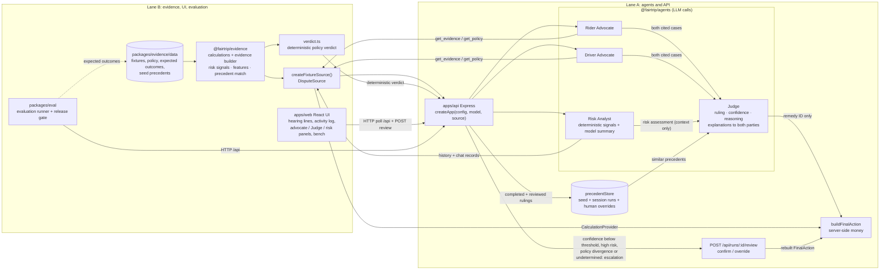

# FairTrip Architecture and Technical Documentation

**Project:** FairTrip — Ryde Multi-Agent Dispute Resolution Prototype
**Version:** contract and workflow 0.3.3 (§11 describes the integrated system; §1–§10 are the original Lane A record)
**Date:** 2026-10-16 (original Lane A record dated 2026-10-11)
**Published Lane A baseline:** `37c7506`

---

## 1. Architecture

### 1.1 System Overview

FairTrip resolves ride-hailing disputes through three distinct LLM agents:

1. **Rider Advocate** — Gathers evidence and builds the rider's case
2. **Driver Advocate** — Gathers evidence and builds the driver's defense
3. **Judge** — Reviews both cases, applies policy, and selects a remedy

A fourth, context-only **Risk Analyst** agent was added as a stretch goal: it runs in parallel with the advocates over deterministic, server-computed risk signals and provides context to the Judge — it can never create a signal or change a ruling (see §11.1).

The server constructs the final monetary action from the Judge's remedy selection. The labeled mock calculations described below remain the stub/test path; live mode now uses Lane B fixtures and deterministic calculations through the `DisputeSource` seam (see §11).

### 1.2 Component Diagram

```
┌─────────────────────────────────────────────────────────────────────────┐
│                           Client (Browser)                               │
│  ┌─────────────┐  ┌─────────────┐  ┌─────────────┐  ┌─────────────────┐ │
│  │   Fixture   │  │   Run       │  │   Poll      │  │   Export        │ │
│  │   Selector  │  │   Creator   │  │   Status    │  │   Trace         │ │
│  └──────┬──────┘  └──────┬──────┘  └──────┬──────┘  └─────────────────┘ │
└─────────┼────────────────┼────────────────┼─────────────────────────────┘
          │ POST /api/runs │                │ GET /api/runs/:id
          ▼                ▼                ▼
┌─────────────────────────────────────────────────────────────────────────┐
│                         API Server (Express)                             │
│  ┌─────────────┐  ┌─────────────┐  ┌─────────────┐  ┌─────────────────┐ │
│  │   Health    │  │   Fixtures  │  │   Run       │  │   Run Query     │ │
│  │   /health   │  │   /fixtures │  │   Creator   │  │   /runs/:id     │ │
│  └─────────────┘  └─────────────┘  └──────┬──────┘  └─────────────────┘ │
│                                           │                              │
│                              ┌────────────┴────────────┐                 │
│                              │    In-Memory Store      │                 │
│                              │    (Map<string, Run>)   │                 │
│                              └─────────────────────────┘                 │
└─────────────────────────────────────────────────────────────────────────┘
          │
          ▼
┌─────────────────────────────────────────────────────────────────────────┐
│                        Agent Orchestration                               │
│  ┌─────────────────────────────────────────────────────────────────┐    │
│  │  runWorkflow(dispute, roles, evidence, policies, signal, emitter)│   │
│  │                                                                  │   │
│  │  ┌─────────────┐              ┌─────────────┐                   │   │
│  │  │ Rider       │  Parallel    │ Driver      │                   │   │
│  │  │ Advocate    │◄────────────►│ Advocate    │                   │   │
│  │  │ (tool loop) │              │ (tool loop) │                   │   │
│  │  └──────┬──────┘              └──────┬──────┘                   │   │
│  │         │                            │                          │   │
│  │         ▼                            ▼                          │   │
│  │  ┌─────────────────────────────────────────┐                    │   │
│  │  │         EvidenceTools (mock/partner)     │                    │   │
│  │  │  get_evidence({sources})                 │                    │   │
│  │  │  get_policy({category})                  │                    │   │
│  │  └─────────────────────────────────────────┘                    │   │
│  │         │                            │                          │   │
│  │         ▼                            ▼                          │   │
│  │  ┌─────────────┐              ┌─────────────┐                   │   │
│  │  │ Rider Case  │              │ Driver Case │                   │   │
│  │  │ (validated) │              │ (validated) │                   │   │
│  │  └──────┬──────┘              └──────┬──────┘                   │   │
│  │         │                            │                          │   │
│  │         └────────────┬───────────────┘                          │   │
│  │                      ▼                                          │   │
│  │               ┌─────────────┐                                   │   │
│  │               │    Judge    │                                   │   │
│  │               │  (model)    │                                   │   │
│  │               └──────┬──────┘                                   │   │
│  │                      │                                          │   │
│  │                      ▼                                          │   │
│  │         ┌─────────────────────────┐                            │   │
│  │         │  Remedy Builder         │                            │   │
│  │         │  (server-constructed)   │                            │   │
│  │         └─────────────────────────┘                            │   │
│  └─────────────────────────────────────────────────────────────────┘    │
└─────────────────────────────────────────────────────────────────────────┘
```

The Risk Analyst (stretch goal, §11.1) executes in the same parallel phase as the two advocates; its assessment is handed to the Judge together with the matched precedents at the handoff.

### 1.3 Data Flow

1. **Filing:** Client POSTs `fixtureId` + optional `riderClaim` → server creates Run (queued)
2. **Advocacy:** Both advocates start in parallel, each with its own tool loop
   - Max 2 tool-request rounds per advocate
   - Max 2 repair attempts per advocate (shared by parse repairs, citation repairs, and redundant/over-budget tool-request nudges)
   - 45-second timeout per model request attempt, 1 retry on timeout/network/5xx (95 s budget per call; the 90 s run deadline bounds a double timeout)
3. **Validation:** Each advocate case is schema-validated and citation-checked against its retrieval scope
4. **Judge Handoff:** Only after both cases pass validation does the Judge start
5. **Adjudication:** Judge receives both cases + retrieved evidence + policy + permitted remedies
6. **Action Construction:** Server builds `FinalAction` from Judge's `remedyId` using `CalculationProvider`
7. **Result:** Run transitions to `completed`, `incomplete`, or `failed`

### 1.4 Event Flow

```
run.started
├── rider: model.start
├── rider: model.finish
├── rider: tool.requested (optional)
├── rider: evidence.retrieved / policy.retrieved (optional)
├── rider: output.repair (optional)
├── rider: case.completed
├── driver: model.start
├── driver: model.finish
├── driver: tool.requested (optional)
├── driver: evidence.retrieved / policy.retrieved (optional)
├── driver: output.repair (optional)
├── driver: case.completed
├── judge: judge.started
├── judge: model.start
├── judge: model.finish
└── system: run.completed / run.incomplete / run.failed
```

---

## 2. Startup and Verification

### 2.1 Prerequisites

- Node.js 22.23.3 (see `.node-version`)
- npm 10.9.9
- No credentials required for stub mode

### 2.2 Installation

```bash
cd <Project-Folder>
npm ci
```

### 2.3 Verification

```bash
npm run verify
```

This runs: `typecheck` → `test` → `build` → `check:examples` → `check:setup`

Expected output: all 924 root tests and 104 web tests pass, 0 build errors, examples validate.

### 2.4 Start the API (Stub Mode)

```bash
npm run dev
```

Server starts on `127.0.0.1:3001`. Health endpoint: `GET /api/health`

### 2.5 Start the API (Live Mode)

```bash
cp .env.example .env
# Edit .env: RUN_MODE=live, MODEL_API_KEY=..., MODEL_BASE_URL=..., MODEL_NAME=...
npm run dev
```

### 2.6 Run Tests Only

```bash
npm test              # all tests
npx vitest run tests/tool-loop.test.ts   # specific file
```

---

## 3. Prompt Design

### 3.1 Advocate Prompts

Each advocate receives:
- Dispute context (ID, category, claims)
- Role definition (represent rider or driver)
- Tool protocol instructions (JSON format for tool requests)
- Citation rules (only cite retrieved evidence/policy)
- Final case format (strict JSON schema)

**Key design decisions:**
- Advocates are NOT preloaded with evidence — they must request it via tools
- Tool requests are validated JSON, not free-form text
- Each advocate has independent retrieval scope; citations are checked against it

### 3.2 Judge Prompt

The Judge receives:
- Both validated advocate cases
- The retrieved evidence and policy records (the "source union")
- Permitted remedy IDs (not amounts)
- Instructions to select only a remedy ID, not monetary values

**Key design decisions:**
- Judge never generates money — the server constructs `FinalAction`
- This prevents model hallucination of amounts and ensures deterministic validation
- Missing decisive evidence must produce `incomplete` ruling

---

## 4. Tool-Use Protocol

### 4.1 Advocate Response Format

Discriminated union:

```typescript
// Request tools
{type: "tool_request", tools: [
  {name: "get_evidence", input: {sources: ["gps", "chat"]}},
  {name: "get_policy", input: {category: "route_deviation"}}
]}

// Final case
{type: "final_case", case: AdvocateCase}
```

The loop appends the raw assistant turn to the conversation before each tool round's result messages, so the model always sees that it already asked — some providers re-issue an identical request when the transcript lacks it. The loop also tracks the sources/categories already requested: a `tool_request` covering only material already provided is redundant and gets a directed `output.repair` nudge ("everything was already returned; respond with `final_case`") instead of re-running tools or spending a round. A fresh request that arrives after the round budget gets the same nudge, prefixed `You have used all N tool rounds.`; the loop only throws `exceeded maximum tool rounds` when the shared repair budget is exhausted.

### 4.2 Execution Limits

| Limit | Value | Enforcement |
|---|---|---|
| Tool rounds per advocate | 2 | Loop counter in `runAdvocateToolLoop` |
| Repair attempts per advocate | 2 | Counter in catch block |
| Model request timeout | 45s per attempt, 1 retry on timeout/network/5xx (95s budget per call) | `AbortSignal.timeout(45000)` per attempt; `createModelAdapter` retries |
| Run deadline | 90s | `AbortController` with `setTimeout(90000)` |

### 4.3 Mock Evidence Provider

When partner adapters are unavailable, `createMockEvidenceTools(dispute)` returns labeled synthetic data:

| Family | Route Deviation | No-Show |
|---|---|---|
| GPS | Actual vs reference route, distances | Pickup proximity, waiting time |
| Chat | Messages between rider/driver | Contact attempts |
| Payment | Itemized fare breakdown | Cancellation fee |
| History | Dispute counts, ratings | Dispute counts, ratings |

All provenance is marked `kind: 'contract_example'` with description noting mock origin.

**Live mode (Lane B integrated):** `RUN_MODE=live` no longer uses this mock provider. The API receives `createFixtureSource()` from `@fairtrip/evidence` as its `DisputeSource`, which serves Lane B fixtures, evidence records, policy clauses and money calculations (see §11). The mock path above is retained as the stub/test path: it backs `RUN_MODE=stub` and Lane A's tests, which do not pass a source.

---

## 5. Validation and Failure Handling

### 5.1 Citation Validation

`validateCitations(cases, result, evidence, policies)` checks:
- All `evidenceIds` in arguments/counterevidence/findings exist in the provided evidence set
- All `policyClauseIds` exist in the provided policy set
- No duplicate source identifiers

### 5.2 Remedy Validation

`buildFinalAction(modelResponse, evidence, calculationProvider, disputeCategory)` checks:
- Remedy ID is appropriate for dispute category
- Amount is integer, non-negative, finite SGD cents
- Refund does not exceed paid charge cap
- `keep_charge` has zero amount and no recipient

### 5.3 Failure Modes

| Scenario | Behavior | Event |
|---|---|---|
| Invalid advocate JSON | 2 repair attempts, then fail | `output.repair` → `run.failed` |
| Wrong advocate side | Fail immediately | `run.failed` |
| Invented citation | Fail during validation | `run.failed` |
| One advocate fails | Sibling cancelled, Judge not called | `run.failed` |
| Model timeout | Per-attempt abort, one retry, then abort | `run.failed` |
| Run deadline exceeded | Abort controller triggers | `run.failed` |
| Missing decisive evidence | `incomplete` ruling, no invented amount; the same guard turns a mid-workflow failure into `incomplete` instead of `failed` — the terminal status is predetermined by the missing family, whatever the model did | `run.incomplete` |
| Wrong-category remedy | Run is incomplete with a validation error and no result/action | `run.incomplete` |
| Excessive refund | Capped at paid charge when the calculation is otherwise valid | `run.completed` |

---

## 6. Measured Prototype Results

### 6.1 Test Coverage

| Test File | Tests | Coverage |
|---|---|---|
| `contracts.test.ts` | 12 | Schema validation, citation checks, event types |
| `workflow.test.ts` | 6 | Parallel advocates, Judge ordering, cancellation, event emission |
| `api.test.ts` | 4 | End-to-end stub flow, concurrent isolation, input validation |
| `config-model.test.ts` | 4 | Config parsing, model adapter, error sanitization |
| `tool-loop.test.ts` | 12 | Tool protocol, repair, rounds, deduplication, sanitized errors |
| `remedy-validation.test.ts` | 9 | Remedy construction, authoritative category validation, caps |
| `failure-coverage.test.ts` | 7 | Advocate failure, sibling cancellation, citations; changed-history acceptance remains pending |
| `live-wiring.test.ts` | 9 | Live callbacks with scripted responses, retrieval, Judge context/repair, incomplete outcomes, outages, deadline |
| `codebuddy-env.test.ts` | 5 | Configuration fallback, explicit precedence, matching-provider checks |
| **Total** | **68** | |

### 6.2 Build and Verification

| Check | Status |
|---|---|
| TypeScript typecheck | Pass (strict mode) |
| Test suite | 67/67 pass across 9 files at the time of the Lane A record; 928 root tests across 51 files and 124 web tests across 14 files on 2026-10-16 |
| Build (contracts → agents → api) | Pass |
| Example validation | Pass |
| Setup verification | Pass |

### 6.3 Limitations

- **Live model:** Resolved in Lane B (LB-11, LB-15): MiniMax-M3 through the OpenAI-compatible endpoint completes real three-agent runs; measured results are in §11 and `submission/metrics/`
- **Partner calculations:** Resolved: live mode uses Lane B's `CalculationProvider` through the `DisputeSource` seam (§11); the mock provider remains the stub/test path
- **Partner fixtures:** Resolved: 20 synthetic Lane B fixtures with expected outcomes live in `packages/evidence/data/`
- **Frontend:** Resolved: `apps/web` single-screen React UI (LB-12, LB-13)
- **Evaluation:** Resolved: `packages/eval` runner with release gate; a real-model scorecard is saved in `submission/metrics/` (LB-14, LB-15)
- **Persistence:** In-memory only; no database
- **Authentication:** Not implemented
- **Hosting:** Local development only

---

## 7. Demonstration Narration

### 7.1 Lane A route example — illustrative mock calculation

**Setup:** Rider claims driver took a longer route without justification. This narration illustrates the mock protocol; it is not an observed real-model run or an accepted Lane B R1 golden outcome.

**Flow:**
1. Rider Advocate requests GPS and payment evidence
2. Driver Advocate requests GPS and policy
3. Both cases are validated and cite actual retrieved records
4. Judge receives: GPS shows 3200m actual vs 2800m reference (14% excess), no rider consent in chat, no documented diversion
5. Judge selects `refund_route_excess`
6. Server calculates: eligible excess = 200 cents, capped at total paid (770 cents) → refund 200 cents
7. Result: `rider_favored`, partial refund of 200 SGD cents

### 7.2 Incomplete — Missing Decisive Evidence

**Setup:** Dispute filed but GPS records are unavailable.

**Flow:**
1. Rider Advocate requests GPS evidence → empty result
2. Driver Advocate requests GPS evidence → empty result
3. Both cases note missing GPS in `missingFacts`
4. Judge receives cases with no GPS evidence
5. Judge rules `incomplete` — cannot determine if detour occurred
6. Server produces no monetary action
7. Result: `incomplete`, missing evidence identified

---

## 8. Development Evidence

Genuine CodeBuddy development screenshots to capture:

1. **CB-01 implementation** — Contract revision with `JudgeModelResponse` split
2. **CB-02 implementation** — Tool loop execution with mock model responses
3. **CB-04 verification** — Genuine CodeBuddy view of the current test suite; this audit passes 67 tests

Current screenshot archive and captions (Lane A and Lane B captures): `docs/evidence/README.md`

---

## 9. Repository Structure

```
fairtrip/
├── apps/
│   ├── api/              # Express API (Lane A)
│   │   ├── src/
│   │   │   ├── app.ts    # Routes, run controller, terminal guards
│   │   │   ├── catalog.ts # Fixture loader
│   │   │   ├── config.ts  # Environment validation
│   │   │   ├── model.ts   # OpenAI-compatible adapter
│   │   │   ├── live-roles.ts # Live callbacks using Lane A examples
│   │   │   └── server.ts  # Entry point
│   │   └── package.json
│   └── web/              # React frontend (Lane B)
├── packages/
│   ├── contracts/        # Zod schemas (shared)
│   │   └── src/index.ts  # All schemas, types, validation
│   └── agents/           # Agent framework (Lane A)
│       └── src/
│           ├── index.ts       # runWorkflow, interfaces
│           ├── prompts.ts     # Role prompts
│           ├── tool-loop.ts   # Advocate tool execution
│           ├── mock-evidence.ts # Mock evidence provider
│           └── remedy-builder.ts # FinalAction construction
├── tests/
│   ├── contracts.test.ts
│   ├── workflow.test.ts
│   ├── api.test.ts
│   ├── config-model.test.ts
│   ├── tool-loop.test.ts
│   ├── remedy-validation.test.ts
│   ├── failure-coverage.test.ts
│   ├── live-wiring.test.ts
│   └── codebuddy-env.test.ts
├── examples/
│   ├── catalog.json      # Contract examples
│   ├── run.json          # Complete run example
│   └── final-action.json # Action example
├── docs/
│   ├── CONTRACTS.md      # Contract documentation
│   └── ARCHITECTURE.md   # This file
└── scripts/
    ├── check-examples.ts
    ├── codebuddy-env.ts
    ├── codebuddy-model-config.ts
    ├── check-model.ts
    └── check-setup.ts
```

---

## 10. Branch Structure

| Branch | Purpose | Current SHA |
|---|---|---|
| `main` | Shared collaboration history | Joins original main `c447e68` and Lane A `bbbe32d`; see Git history for the merge commit |
| `lane-a` | Lane A development | Verified code audit `c163321`; publication documentation follows |
| `lane-b` | Partner development (separate) | `origin/lane-b`: `e2ad1e3` |
| `ryde-integration` | Combined testing | `0ebd544` (Lane A pin) |

---

## 11. Integrated system (Lane A + Lane B)

Lane B adds the evidence layer, the web UI and the evaluation runner, and connects them to Lane A through one seam. The diagram below is the authoritative integration design (SPEC §1):



Rendered image of this diagram: [docs/architecture.png](architecture.png) (generated from the block above; regenerate after editing it).

**The `DisputeSource` seam.** `createApp(config, model, source)` takes an optional third argument. With `RUN_MODE=stub` the source is ignored and Lane A's labelled contract examples are served exactly as before, so Lane A's tests keep testing the mock path unchanged. With `RUN_MODE=live` the server passes `createFixtureSource()` from `@fairtrip/evidence`: the advocates' `get_evidence` / `get_policy` tool calls, the policy clauses and the `CalculationProvider` money all come from Lane B's synthetic fixtures and demonstration policy. The Judge never produces money — it selects a remedy ID and `buildFinalAction` asks Lane B's calculation provider for the integer-cents amount.

**Decisive-evidence guard.** A deterministic guard marks a run `incomplete` when decisive evidence (GPS or payment) is unavailable, whatever the Judge said. No amount is invented and the UI shows the missing-evidence list with a human-review note (fixtures X1, X4, X3 and X5 exercise this path).

**Evaluation runner.** `packages/eval` drives the live API over HTTP, compares each run against the expected outcomes in `packages/evidence/data` (status, remedy, amount, citations, trace completeness, consistency, latency, policy verdict), follows the API's automatic re-run after a provider failure, enforces the eight-condition release gate and writes a scorecard to `submission/metrics/`. The fixture set was extended on 2026-10-13 from eleven to twenty so that every policy branch, every Risk Analyst signal in both party directions, both prompt-injection directions, both missing-family cases per category and every precedent feature/seed is exercised; `packages/evidence/test/coverage.test.ts` guards that coverage. The release set is 26 planned runs (R1, N2 and R1F three consecutive attempts each, the rest once) plus one human-review feedback probe — confirm X2, override N2H, then re-run N2 — gated by the `human-review-feedback` condition. The web UI (`apps/web`) polls the same `/api` endpoints and renders every event, so the whole inter-agent exchange stays observable.

### 11.1 Stretch goals (contract 0.3.0)

Three optional capabilities extend the loop without changing what decides a case.

**Risk Analyst.** `packages/evidence/src/risk.ts` computes a deterministic `RiskAssessment` (overall severity plus per-party signals with evidence citations) from a dispute's history and chat records; the thresholds in `RISK_PARAMS` are demonstration heuristics, not Ryde rules. The optional `roles.risk` callback (`packages/agents/src/risk-analyst.ts`) runs in the same parallel phase as the advocates and asks the model only to write the summary text; if the model fails, the assessment is returned unchanged with `source: 'deterministic'`. The model never produces or removes a risk signal — the signal set is fixed by the evidence layer before the model is called, and every assessment carries the `RISK_CAVEAT` that risk never establishes fault.

**Policy & precedent.** `packages/evidence/src/features.ts` derives case features from the evidence and `packages/evidence/src/precedents.ts` matches them against a store seeded from `packages/evidence/data/precedents.json` (synthetic seed entries). `runWorkflow` emits `precedent.retrieved` before the Judge starts and hands the matched precedents plus the risk assessment to the Judge as context; `JUDGE_CONTEXT_RULES` in `packages/agents/src/prompts.ts` instructs the Judge that both are for consistency only and may never override the case's evidence.

**Escalation and review.** In `apps/api/src/app.ts` a completed live run escalates (`run.escalated`, status stays `completed`) when the model-assessed confidence falls below `ESCALATION_CONFIDENCE_THRESHOLD` (default 0.80) or the risk overall is `high`; the ruling and amount are then recommendations only. Across 141 completed live rulings in seven release-gate runs (2026-10-13/14) the lowest confidence on a correct ruling was 0.80 and the only incorrect ruling (R3, run 20261014-011142) carried 0.78; the default threshold was raised from 0.75 to 0.80 so that ruling would have been escalated. `POST /api/runs/:id/review` lets a human confirm — the Judge's action stands — or override with another permitted remedy, in which case `buildFinalAction` recomputes the money with the same server formulas and the run gains `review.decided`. Confirmed, overridden and unescalated completed rulings are written back into the in-memory precedent store (`GET /api/precedents`) so later runs can match them — the learning feedback loop.

**Invariants.** Risk and precedents are context only: they never change a run's `status`, `remedyId` or `amountCents` — the evaluation runner enforces this with the `riskSignalsIntact` and `contextOnly` checks and the sixth release-gate condition `risk-context-only` (`packages/eval`). An override's money is not free text either: it is computed by the same server formulas in `buildFinalAction`. On the web side, `apps/web` renders the Risk Analyst on a fourth hearing-line lane and a Risk panel, lists the precedents considered in the Judge column, and drives confirm/override from the verdict card (hearing-room UI) or the bench (classic UI).

### 11.2 Replay mode and deep links (contract 0.3.1)

`RUN_MODE=replay` serves the recorded events of a completed release-gate run (default `apps/api/replays/20261013-144417`; `REPLAY_DIR`, `REPLAY_SPEED`) without calling a model. `apps/api/src/replay.ts` loads the raw eval records and the API re-emits each recorded event at its original offset divided by `REPLAY_SPEED`, re-stamped with a fresh run id — the UI renders a replay exactly like a live run while evidence, money, precedent matching and the review endpoint remain real server behaviour (a `runContexts` entry is registered so an escalated replay can still be confirmed or overridden, and those reviews append precedents that later replays match). `GET /api/runs` lists the session's runs newest first; the web header labels replay `Replay of live run · recorded <date>` and each run carries a `?run=<id>` deep link plus a recent-runs select. Contract 0.3.1 adds the `replay` mode and the optional `replay` provenance block on Run (`sourceRunId`, `recordedAt`, `sourceEvalRun`, `speed`).

### 11.3 Deterministic policy verdict and finalisation (contract 0.3.2)

**Verdict engine.** `packages/evidence/src/verdict.ts` computes a `PolicyVerdict` — outcome, clause ids, basis sentence, the features and missing families that decided it — purely from the computed case features and the evidence bundle's unavailable families: the same deterministic inputs the precedent matcher uses, no model involved. `DisputeSource.policyVerdict(dispute)` exposes it to the API (`packages/evidence/src/source.ts`); every live and replay run carries the verdict on the Run and emits a `verdict.computed` system event before the workflow starts.

**Finalisation.** `apps/api/src/finalisation.ts` compares the Judge's remedy with the verdict after `buildFinalAction` succeeds. Equal → the run finalises as before (the existing `low_confidence` and `high_risk` escalations still apply). A remedy outcome that differs → `policy_divergence`: the run completes escalated, the Judge's ruling stays attached as a recommendation, and a `divergence` record carries the Judge's remedy, the verdict outcome and an explanatory sentence. An `undetermined` verdict — e.g. the chat shows both consent and objection — adds `policy_undetermined` and takes the same recommendation path. `incomplete` never reaches this point: the decisive-evidence guard already stops the run. Defence in depth: immediately before the completed snapshot is stored, the server enforces `VERDICT_INVARIANT` — a completed run without an escalation must have `action.remedyId === verdict.outcome` — and fails the run if that is ever violated.

**What the model still produces:** the advocate cases, the findings, the rider/driver explanations and the confidence number. **What it never produces:** the verdict, the money and the status when decisive evidence is missing. A finalised payment can therefore never differ from the demonstration policy; disagreement is always a recommendation waiting for a human, and the verdict card (bench in the classic UI) offers "Apply policy verdict" on a divergent run (an override to the verdict remedy, with the money rebuilt server-side).

**Automatic re-run.** When a first-attempt workflow fails — provider-side (attempt timeout, network failure, run deadline) or model-output (invalid JSON, schema violation, bad citations, wrong advocate side) — the API marks the run `failed` with `retriedBy`, emits `run.retrying` and starts exactly one automatic re-run for the same dispute (`retryOf` links back; `GET /api/runs/:id` on the first attempt still returns `failed` so a client can follow the link). The only non-retryable failures are internal ones the system itself guarantees never to reach: a `VERDICT_INVARIANT` violation or a `REPLAY_INVALID` tamper detection — re-running those would repeat the same guaranteed failure. A second failure is never re-run. Validation repairs inside an attempt now report a safe classified reason (`invalid JSON`, `schema: <paths>`, or the citation id) — never raw model text — in the `output.repair` event and the thrown error. The eval runner and the web UI both follow `retriedBy` automatically; the eval reports the re-run's own latency separately from the whole-round-trip wall time.

**Latency controls (contract 0.3.3).** Three knobs cut model wall-time and wasted re-runs. **Thinking:** calls carry a `thinking` option — `off` for the cheap tool-request turn and the Risk Analyst (a rephrase-only role), `MODEL_THINKING` (`default`/`adaptive`/`off`, default `adaptive`) for the case and Judge calls; `reasoning_split: true` is sent on every request so thinking lands in `reasoning_content`, never in `content`. **Normalise vs repair:** before the strict schema parse, `normaliseJudgeOutput`/`normaliseAdvocateOutput` fix cosmetic faults — invented non-money keys are dropped, a missing/typo'd `ruling` is derived from a valid `remedyId`, a missing response `type` is inferred, singleton id strings are wrapped in arrays and an invalid `requestedRemedyId` is dropped (the field is now optional). Decision-bearing fields (remedy, ruling when both are bad, findings absent, claim text, side, any id value) are never normalised, and keys that look like money smuggling (`amount|action|recipient|currency|cents|pay|refund`) are deliberately left in place so the strict schema still rejects them — each normalisation emits `output.normalised`; only what survives goes to a directed repair. **Hedging:** a call unsettled past `hedgeAfterMs` (6 s tool-request / 20 s case / 20 s Judge) starts an identical lane-B request; the first lane to fulfil wins (a lane-B win emits `model.hedge` 'answered first'). **Retries:** network/HTTP transients (TypeError, 408/429/5xx) get up to 2 retries with 300/1000 ms backoff; per-attempt timeouts keep the single no-backoff retry. Recoveries surface as `model.retry`/`model.hedge` events — call-level, never a workflow re-run. `MODEL_SERVICE_TIER=priority` opts into the provider's priority lane. `MODEL_THINKING`, `MODEL_SERVICE_TIER`, `reasoning_split` and `thinking` body fields apply to the MiniMax profile only (detected by a `*.minimax.io` host or a `MiniMax*` model name); every other provider is generic and controls thinking exclusively via `MODEL_EXTRA_BODY` — e.g. Aliyun DashScope: `{"enable_thinking":false}`. Replay mode is unaffected.

**Limits.** The chat-derived features are keyword heuristics over synthetic fixture text — a production system would need structured consent capture; where the heuristics see both consent and objection the verdict is `undetermined` and the case goes to a human instead of guessing. The verdict only covers what the rules cover, and a Judge `incomplete` on a technically decidable case is accepted as conservative.

### 11.4 Adversarial guardrail suite

A permanent suite (`tests/adversarial/`, `packages/evidence/test/adversarial-verdict.test.ts`, `packages/evidence/test/money-invariants.test.ts`) attacks the money path directly: hostile model outputs, hostile fixture inputs, hostile review requests and hostile lifecycle timing. Every guardrail is asserted to fail closed — a failing test is a finding, never weakened.

| Attack class | Attack | Expected system behaviour | Test id |
|---|---|---|---|
| A. Judge | Smuggled `action`/`amountCents` fields | Strict schema rejects; repairs exhaust; run `failed`. A repaired clean output pays only the server-computed amount. | A1 |
| | Over- or under-refund against the verdict | `completed` with `policy_divergence` escalation and a `divergence` record; no review, no run precedent | A2, A3 |
| | Wrong-category remedy | `incomplete`, no result | A4 |
| | Ruling/remedy contradiction | Public ruling normalised to follow the remedy; an `output.repair` event records it | A5 |
| | Abstention on a determinable case | `incomplete`, no payment — conservative, never an automatic refund | A6 |
| | Injection via the POST `riderClaim` | Text stored verbatim as data; verdict recomputed from evidence; obedience escalates as divergence | A7 |
| | Invented evidence/policy citations | Citation validation fails; run `failed` after repairs | A8 |
| | Out-of-range confidence | Strict schema rejects; run `failed` | A9 |
| | Poisoned precedent store | Precedents retrieved as context, never obeyed; divergence escalates | A10 |
| B. Advocate | Fabricated narrative citing a real record | Divergence escalation; no finalisation | B1 |
| | False `missingFacts` | Never drives status; verdict unaffected | B2 |
| | Oversized case (300 arguments, 60 KB summary) | Terminal within the run deadline; API stays healthy | B3 |
| | Side swap | `failed`, no result | B4 |
| | Advocate-declared remedy | Ignored; money comes only from the Judge remedy + server calculation | B5 |
| C. Verdict inputs | Driver manufacturing rider consent | Consent features only ever tag rider text | C1 |
| | Negated agreement | Tags consent AND objection → `undetermined`, never `keep_charge` | C2 |
| | Feature words in chat/dispute text | Text is data; `documented_reroute` needs a real nav/advisory record; dispute text has no effect | C3, C4 |
| | Message flood | 10,000 messages analysed in < 2 s; verdict unchanged | C5 |
| | NS-1 boundary nudges | Each single-condition flip produces the refund verdict | C6 |
| D. Money | Mutated payment facts (surge, paid, items, currency) | Any fare anomaly nulls both refunds; non-null amounts stay integer, ≥ 0, ≤ paid, ≤ their formula cap; `keep_charge` is always 0 | D |
| | Hostile calculation providers | Non-finite/non-integer amounts (`-5`, `NaN`, `Infinity`, `12.5`) error and produce a zero action; finite overshoots are capped at what the rider paid | D |
| E. Review | Money fields in the body | Strict schema → 400 | E1 |
| | Non-remedy / wrong-category remedy | 400 / 422 | E2 |
| | Repeat or out-of-state review | 409 (already reviewed, not escalated, running) / 404 unknown | E3, E4 |
| | Oversized / injection note | 400 over the limit; otherwise stored verbatim, action unchanged | E5 |
| | Concurrent overrides | Exactly one wins; exactly one `human_override` precedent | E6 |
| F. Lifecycle | Late model response after the deadline | The `failed` first run never gains a result; the single automatic re-run pays once | F1 |
| | Re-run chains | At most two runs: one automatic re-run per first-attempt failure (invariant/replay failures excepted), never a third | F2 |
| | Concurrent starts | Documented gap — no dedupe; see Known gaps | F3 |
| | Tampered replay record | Recorded money is recomputed server-side; mismatch → `failed` with `REPLAY_INVALID` naming both amounts | F4 |

**Known gaps (documented, not hidden):**
- **No per-dispute idempotency** — five concurrent POSTs produce five independent rulings (F3). Payments are recommendations; a real execution layer must key on dispute id.
- **Chat-consent heuristics** — keyword tags over untrusted text; a crafted negation can tag consent and objection together. The verdict fails safe to `undetermined` and a human decides (C2).
- **Judge abstention is conservative, not automatic** — `incomplete` on a decidable case produces an incomplete run, never a payment (A6).
- **Divergent replay escalates like a live divergence** — a recorded run whose remedy differs from the recomputed verdict replays as an escalated recommendation with a `divergence` record, never finalised (F4); `VERDICT_INVARIANT` remains as defence in depth for the case where divergence detection itself fails to escalate.
- **Provider amounts are validated before capping** — a non-finite, negative or non-integer `CalculationProvider` amount or cap is rejected (`INVALID_CALCULATION`, zero action); a finite overshoot is capped at the paid charge (D).

---

*Current verification results and measured metrics are recorded in the root `README.md` and `submission/metrics/`. Mocked protocol results do not establish real model quality or release readiness.*
