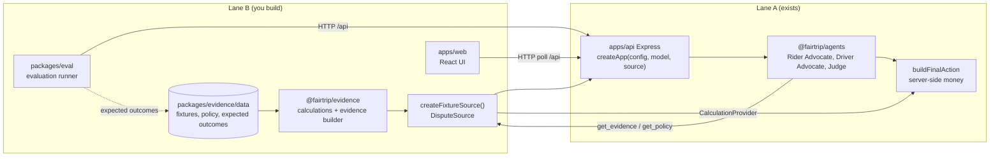

# FairTrip Architecture and Technical Documentation

**Project:** FairTrip — Ryde Multi-Agent Dispute Resolution Prototype
**Version:** 0.2.0
**Date:** 2026-10-11 (Asia/Kuala_Lumpur)
**Published Lane A baseline:** `37c7506`; local audit source is described in [LANE_A_STATUS.md](LANE_A_STATUS.md)

---

## 1. Architecture

### 1.1 System Overview

FairTrip resolves ride-hailing disputes through three distinct LLM agents:

1. **Rider Advocate** — Gathers evidence and builds the rider's case
2. **Driver Advocate** — Gathers evidence and builds the driver's defense
3. **Judge** — Reviews both cases, applies policy, and selects a remedy

The server constructs the final monetary action from the Judge's remedy selection. The labeled mock calculations described below remain the stub/test path; live mode now uses Lane B fixtures and deterministic calculations through the `DisputeSource` seam (see §11).

### 1.2 Component Diagram

```
┌─────────────────────────────────────────────────────────────────────────┐
│                           Client (Browser)                               │
│  ┌─────────────┐  ┌─────────────┐  ┌─────────────┐  ┌─────────────────┐ │
│  │   Fixture   │  │   Run       │  │   Poll      │  │   Export        │ │
│  │   Selector  │  │   Creator   │  │   Status    │  │   Trace         │ │
│  └──────┬──────┘  └──────┬──────┘  └──────┬──────┘  └─────────────────┘ │
└─────────┼────────────────┼────────────────┼─────────────────────────────┘
          │ POST /api/runs │                │ GET /api/runs/:id
          ▼                ▼                ▼
┌─────────────────────────────────────────────────────────────────────────┐
│                         API Server (Express)                             │
│  ┌─────────────┐  ┌─────────────┐  ┌─────────────┐  ┌─────────────────┐ │
│  │   Health    │  │   Fixtures  │  │   Run       │  │   Run Query     │ │
│  │   /health   │  │   /fixtures │  │   Creator   │  │   /runs/:id     │ │
│  └─────────────┘  └─────────────┘  └──────┬──────┘  └─────────────────┘ │
│                                           │                              │
│                              ┌────────────┴────────────┐                 │
│                              │    In-Memory Store      │                 │
│                              │    (Map<string, Run>)   │                 │
│                              └─────────────────────────┘                 │
└─────────────────────────────────────────────────────────────────────────┘
          │
          ▼
┌─────────────────────────────────────────────────────────────────────────┐
│                        Agent Orchestration                               │
│  ┌─────────────────────────────────────────────────────────────────┐    │
│  │  runWorkflow(dispute, roles, evidence, policies, signal, emitter)│   │
│  │                                                                  │   │
│  │  ┌─────────────┐              ┌─────────────┐                   │   │
│  │  │ Rider       │  Parallel    │ Driver      │                   │   │
│  │  │ Advocate    │◄────────────►│ Advocate    │                   │   │
│  │  │ (tool loop) │              │ (tool loop) │                   │   │
│  │  └──────┬──────┘              └──────┬──────┘                   │   │
│  │         │                            │                          │   │
│  │         ▼                            ▼                          │   │
│  │  ┌─────────────────────────────────────────┐                    │   │
│  │  │         EvidenceTools (mock/partner)     │                    │   │
│  │  │  get_evidence({sources})                 │                    │   │
│  │  │  get_policy({category})                  │                    │   │
│  │  └─────────────────────────────────────────┘                    │   │
│  │         │                            │                          │   │
│  │         ▼                            ▼                          │   │
│  │  ┌─────────────┐              ┌─────────────┐                   │   │
│  │  │ Rider Case  │              │ Driver Case │                   │   │
│  │  │ (validated) │              │ (validated) │                   │   │
│  │  └──────┬──────┘              └──────┬──────┘                   │   │
│  │         │                            │                          │   │
│  │         └────────────┬───────────────┘                          │   │
│  │                      ▼                                          │   │
│  │               ┌─────────────┐                                   │   │
│  │               │    Judge    │                                   │   │
│  │               │  (model)    │                                   │   │
│  │               └──────┬──────┘                                   │   │
│  │                      │                                          │   │
│  │                      ▼                                          │   │
│  │         ┌─────────────────────────┐                            │   │
│  │         │  Remedy Builder         │                            │   │
│  │         │  (server-constructed)   │                            │   │
│  │         └─────────────────────────┘                            │   │
│  └─────────────────────────────────────────────────────────────────┘    │
└─────────────────────────────────────────────────────────────────────────┘
```

### 1.3 Data Flow

1. **Filing:** Client POSTs `fixtureId` + optional `riderClaim` → server creates Run (queued)
2. **Advocacy:** Both advocates start in parallel, each with its own tool loop
   - Max 2 tool-request rounds per advocate
   - Max 1 repair attempt per advocate
   - 20-second timeout per model request
3. **Validation:** Each advocate case is schema-validated and citation-checked against its retrieval scope
4. **Judge Handoff:** Only after both cases pass validation does the Judge start
5. **Adjudication:** Judge receives both cases + retrieved evidence + policy + permitted remedies
6. **Action Construction:** Server builds `FinalAction` from Judge's `remedyId` using `CalculationProvider`
7. **Result:** Run transitions to `completed`, `incomplete`, or `failed`

### 1.4 Event Flow

```
run.started
├── rider: model.start
├── rider: model.finish
├── rider: tool.requested (optional)
├── rider: evidence.retrieved / policy.retrieved (optional)
├── rider: output.repair (optional)
├── rider: case.completed
├── driver: model.start
├── driver: model.finish
├── driver: tool.requested (optional)
├── driver: evidence.retrieved / policy.retrieved (optional)
├── driver: output.repair (optional)
├── driver: case.completed
├── judge: judge.started
├── judge: model.start
├── judge: model.finish
└── system: run.completed / run.incomplete / run.failed
```

---

## 2. Startup and Verification

### 2.1 Prerequisites

- Node.js 22.23.3 (see `.node-version`)
- npm 10.9.9
- No credentials required for stub mode

### 2.2 Installation

```bash
cd /Users/lane-a-owner/Documents/ChatGPT/Tencent
npm ci
```

### 2.3 Verification

```bash
npm run verify
```

This runs: `typecheck` → `test` → `build` → `check:examples` → `check:setup`

Expected output: all 280 root tests and 28 web tests pass, 0 build errors, examples validate.

### 2.4 Start the API (Stub Mode)

```bash
npm run dev
```

Server starts on `127.0.0.1:3001`. Health endpoint: `GET /api/health`

### 2.5 Start the API (Live Mode)

```bash
cp .env.example .env
# Edit .env: RUN_MODE=live, MODEL_API_KEY=..., MODEL_BASE_URL=..., MODEL_NAME=...
npm run dev
```

### 2.6 Run Tests Only

```bash
npm test              # all tests
npx vitest run tests/tool-loop.test.ts   # specific file
```

---

## 3. Prompt Design

### 3.1 Advocate Prompts

Each advocate receives:
- Dispute context (ID, category, claims)
- Role definition (represent rider or driver)
- Tool protocol instructions (JSON format for tool requests)
- Citation rules (only cite retrieved evidence/policy)
- Final case format (strict JSON schema)

**Key design decisions:**
- Advocates are NOT preloaded with evidence — they must request it via tools
- Tool requests are validated JSON, not free-form text
- Each advocate has independent retrieval scope; citations are checked against it

### 3.2 Judge Prompt

The Judge receives:
- Both validated advocate cases
- The retrieved evidence and policy records (the "source union")
- Permitted remedy IDs (not amounts)
- Instructions to select only a remedy ID, not monetary values

**Key design decisions:**
- Judge never generates money — the server constructs `FinalAction`
- This prevents model hallucination of amounts and ensures deterministic validation
- Missing decisive evidence must produce `incomplete` ruling

---

## 4. Tool-Use Protocol

### 4.1 Advocate Response Format

Discriminated union:

```typescript
// Request tools
{type: "tool_request", tools: [
  {name: "get_evidence", input: {sources: ["gps", "chat"]}},
  {name: "get_policy", input: {category: "route_deviation"}}
]}

// Final case
{type: "final_case", case: AdvocateCase}
```

### 4.2 Execution Limits

| Limit | Value | Enforcement |
|---|---|---|
| Tool rounds per advocate | 2 | Loop counter in `runAdvocateToolLoop` |
| Repair attempts per advocate | 1 | Counter in catch block |
| Model request timeout | 20s | `AbortSignal.timeout(20000)` |
| Run deadline | 90s | `AbortController` with `setTimeout(90000)` |

### 4.3 Mock Evidence Provider

When partner adapters are unavailable, `createMockEvidenceTools(dispute)` returns labeled synthetic data:

| Family | Route Deviation | No-Show |
|---|---|---|
| GPS | Actual vs reference route, distances | Pickup proximity, waiting time |
| Chat | Messages between rider/driver | Contact attempts |
| Payment | Itemized fare breakdown | Cancellation fee |
| History | Dispute counts, ratings | Dispute counts, ratings |

All provenance is marked `kind: 'contract_example'` with description noting mock origin.

**Live mode (Lane B integrated):** `RUN_MODE=live` no longer uses this mock provider. The API receives `createFixtureSource()` from `@fairtrip/evidence` as its `DisputeSource`, which serves Lane B fixtures, evidence records, policy clauses and money calculations (see §11). The mock path above is retained as the stub/test path: it backs `RUN_MODE=stub` and Lane A's tests, which do not pass a source.

---

## 5. Validation and Failure Handling

### 5.1 Citation Validation

`validateCitations(cases, result, evidence, policies)` checks:
- All `evidenceIds` in arguments/counterevidence/findings exist in the provided evidence set
- All `policyClauseIds` exist in the provided policy set
- No duplicate source identifiers

### 5.2 Remedy Validation

`buildFinalAction(modelResponse, evidence, calculationProvider, disputeCategory)` checks:
- Remedy ID is appropriate for dispute category
- Amount is integer, non-negative, finite SGD cents
- Refund does not exceed paid charge cap
- `keep_charge` has zero amount and no recipient

### 5.3 Failure Modes

| Scenario | Behavior | Event |
|---|---|---|
| Invalid advocate JSON | 1 repair attempt, then fail | `output.repair` → `run.failed` |
| Wrong advocate side | Fail immediately | `run.failed` |
| Invented citation | Fail during validation | `run.failed` |
| One advocate fails | Sibling cancelled, Judge not called | `run.failed` |
| Model timeout | Abort signal triggers | `run.failed` |
| Run deadline exceeded | Abort controller triggers | `run.failed` |
| Missing decisive evidence | `incomplete` ruling, no invented amount | `run.incomplete` |
| Wrong-category remedy | Run is incomplete with a validation error and no result/action | `run.incomplete` |
| Excessive refund | Capped at paid charge when the calculation is otherwise valid | `run.completed` |

---

## 6. Measured Prototype Results

### 6.1 Test Coverage

| Test File | Tests | Coverage |
|---|---|---|
| `contracts.test.ts` | 12 | Schema validation, citation checks, event types |
| `workflow.test.ts` | 6 | Parallel advocates, Judge ordering, cancellation, event emission |
| `api.test.ts` | 4 | End-to-end stub flow, concurrent isolation, input validation |
| `config-model.test.ts` | 4 | Config parsing, model adapter, error sanitization |
| `tool-loop.test.ts` | 11 | Tool protocol, repair, rounds, deduplication, sanitized errors |
| `remedy-validation.test.ts` | 9 | Remedy construction, authoritative category validation, caps |
| `failure-coverage.test.ts` | 7 | Advocate failure, sibling cancellation, citations; changed-history acceptance remains pending |
| `live-wiring.test.ts` | 9 | Live callbacks with scripted responses, retrieval, Judge context/repair, incomplete outcomes, outages, deadline |
| `codebuddy-env.test.ts` | 5 | Configuration fallback, explicit precedence, matching-provider checks |
| **Total** | **67** | |

### 6.2 Build and Verification

| Check | Status |
|---|---|
| TypeScript typecheck | Pass (strict mode) |
| Test suite | 67/67 pass across 9 files |
| Build (contracts → agents → api) | Pass |
| Example validation | Pass |
| Setup verification | Pass |

### 6.3 Limitations

- **Live model:** Resolved in Lane B (LB-11, LB-15): MiniMax-M3 through the OpenAI-compatible endpoint completes real three-agent runs; measured results are in §11 and `submission/metrics/`
- **Partner calculations:** Resolved: live mode uses Lane B's `CalculationProvider` through the `DisputeSource` seam (§11); the mock provider remains the stub/test path
- **Partner fixtures:** Resolved: 11 synthetic Lane B fixtures with expected outcomes live in `packages/evidence/data/`
- **Frontend:** Resolved: `apps/web` single-screen React UI (LB-12, LB-13)
- **Evaluation:** Resolved: `packages/eval` runner with release gate; a real-model scorecard is saved in `submission/metrics/` (LB-14, LB-15)
- **Persistence:** In-memory only; no database
- **Authentication:** Not implemented
- **Hosting:** Local development only

---

## 7. Demonstration Narration

### 7.1 Lane A route example — illustrative mock calculation

**Setup:** Rider claims driver took a longer route without justification. This narration illustrates the mock protocol; it is not an observed real-model run or an accepted Lane B R1 golden outcome.

**Flow:**
1. Rider Advocate requests GPS and payment evidence
2. Driver Advocate requests GPS and policy
3. Both cases are validated and cite actual retrieved records
4. Judge receives: GPS shows 3200m actual vs 2800m reference (14% excess), no rider consent in chat, no documented diversion
5. Judge selects `refund_route_excess`
6. Server calculates: eligible excess = 200 cents, capped at total paid (770 cents) → refund 200 cents
7. Result: `rider_favored`, partial refund of 200 SGD cents

### 7.2 Incomplete — Missing Decisive Evidence

**Setup:** Dispute filed but GPS records are unavailable.

**Flow:**
1. Rider Advocate requests GPS evidence → empty result
2. Driver Advocate requests GPS evidence → empty result
3. Both cases note missing GPS in `missingFacts`
4. Judge receives cases with no GPS evidence
5. Judge rules `incomplete` — cannot determine if detour occurred
6. Server produces no monetary action
7. Result: `incomplete`, missing evidence identified

---

## 8. Development Evidence

Genuine CodeBuddy development screenshots to capture:

1. **CB-01 implementation** — Contract revision with `JudgeModelResponse` split
2. **CB-02 implementation** — Tool loop execution with mock model responses
3. **CB-04 verification** — Genuine CodeBuddy view of the current test suite; this audit passes 67 tests

Current screenshot archive and captions (Lane A and Lane B captures): `docs/evidence/README.md`

---

## 9. Repository Structure

```
fairtrip/
├── apps/
│   ├── api/              # Express API (Lane A)
│   │   ├── src/
│   │   │   ├── app.ts    # Routes, run controller, terminal guards
│   │   │   ├── catalog.ts # Fixture loader
│   │   │   ├── config.ts  # Environment validation
│   │   │   ├── model.ts   # OpenAI-compatible adapter
│   │   │   ├── live-roles.ts # Live callbacks using Lane A examples
│   │   │   └── server.ts  # Entry point
│   │   └── package.json
│   └── web/              # React frontend (Lane B)
├── packages/
│   ├── contracts/        # Zod schemas (shared)
│   │   └── src/index.ts  # All schemas, types, validation
│   └── agents/           # Agent framework (Lane A)
│       └── src/
│           ├── index.ts       # runWorkflow, interfaces
│           ├── prompts.ts     # Role prompts
│           ├── tool-loop.ts   # Advocate tool execution
│           ├── mock-evidence.ts # Mock evidence provider
│           └── remedy-builder.ts # FinalAction construction
├── tests/
│   ├── contracts.test.ts
│   ├── workflow.test.ts
│   ├── api.test.ts
│   ├── config-model.test.ts
│   ├── tool-loop.test.ts
│   ├── remedy-validation.test.ts
│   ├── failure-coverage.test.ts
│   ├── live-wiring.test.ts
│   └── codebuddy-env.test.ts
├── examples/
│   ├── catalog.json      # Contract examples
│   ├── run.json          # Complete run example
│   └── final-action.json # Action example
├── docs/
│   ├── CONTRACTS.md      # Contract documentation
│   ├── ARCHITECTURE.md   # This file
│   ├── LANE_A_EXECUTION.md
│   └── LANE_A_STATUS.md
└── scripts/
    ├── check-examples.ts
    ├── codebuddy-env.ts
    ├── codebuddy-model-config.ts
    ├── check-model.ts
    └── check-setup.ts
```

---

## 10. Branch Structure

| Branch | Purpose | Current SHA |
|---|---|---|
| `main` | Shared collaboration history | Joins original main `c447e68` and Lane A `bbbe32d`; see Git history for the merge commit |
| `lane-a` | Lane A development | Verified code audit `c163321`; publication documentation follows |
| `lane-b` | Partner development (separate) | `origin/lane-b`: `e2ad1e3` |
| `ryde-integration` | Combined testing | `0ebd544` (Lane A pin) |

---

## 11. Integrated system (Lane A + Lane B)

Lane B adds the evidence layer, the web UI and the evaluation runner, and connects them to Lane A through one seam. The diagram below is the authoritative integration design (SPEC §1):



**The `DisputeSource` seam.** `createApp(config, model, source)` takes an optional third argument. With `RUN_MODE=stub` the source is ignored and Lane A's labelled contract examples are served exactly as before, so Lane A's tests keep testing the mock path unchanged. With `RUN_MODE=live` the server passes `createFixtureSource()` from `@fairtrip/evidence`: the advocates' `get_evidence` / `get_policy` tool calls, the policy clauses and the `CalculationProvider` money all come from Lane B's synthetic fixtures and demonstration policy. The Judge never produces money — it selects a remedy ID and `buildFinalAction` asks Lane B's calculation provider for the integer-cents amount.

**Decisive-evidence guard.** A deterministic guard marks a run `incomplete` when decisive evidence (GPS or payment) is unavailable, whatever the Judge said. No amount is invented and the UI shows the missing-evidence list with a human-review note (fixtures X1 and X3 exercise this path).

**Evaluation runner.** `packages/eval` drives the live API over HTTP, compares each run against the expected outcomes in `packages/evidence/data` (status, remedy, amount, citations, trace completeness, consistency, latency), enforces the five-condition release gate and writes a scorecard to `submission/metrics/`. The web UI (`apps/web`) polls the same `/api` endpoints and renders every event, so the whole inter-agent exchange stays observable.

---

*Current acceptance results and pending work are recorded in [LANE_A_STATUS.md](LANE_A_STATUS.md). Mocked protocol results do not establish real model quality, partner agreement, or release readiness.*
