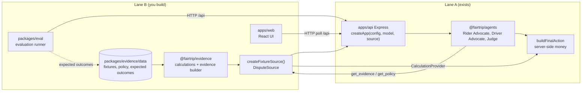

# SPEC §1. Integration design

Part of the FairTrip Lane B specification. Index: `harness/SPEC.md`.

Lane A already runs the three agents. Its advocates call two tools (`get_evidence`, `get_policy`) through an `EvidenceTools` interface, and its server turns the Judge's chosen remedy into money through a `CalculationProvider` interface. Today both are filled by Lane A's mock data. Lane B supplies real implementations through one new seam, `DisputeSource`, which `createApp` receives as an optional third argument. Lane A's 67 existing tests do not pass a source, so they keep testing the mock path unchanged.

Rules of the seam:

- `RUN_MODE=stub`: Lane A's fixed contract examples, exactly as today. The source is ignored.
- `RUN_MODE=live`: the server uses `createFixtureSource()`. Fixtures, evidence, policy and money all come from Lane B.
- The Judge never produces money. It selects a remedy ID; Lane A's `buildFinalAction` asks Lane B's `CalculationProvider` for the amount.
- A deterministic guard marks a run `incomplete` when decisive evidence (GPS or payment) is unavailable, whatever the Judge said.
